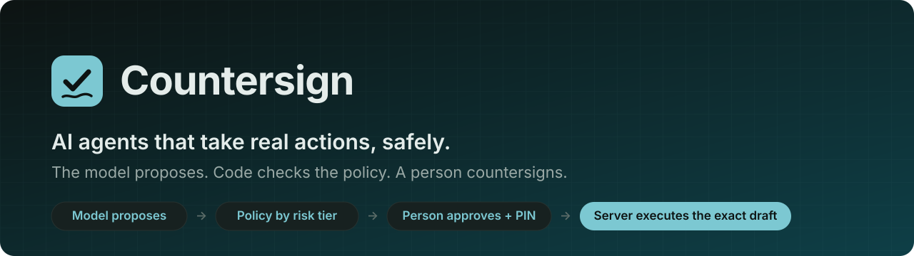
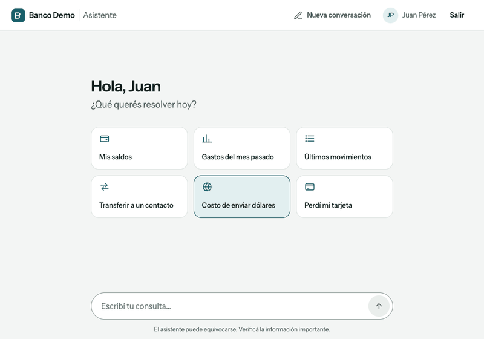
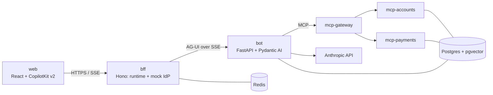

<p align="center">
  
</p>

<p align="center">
  <a href="https://github.com/juanagu/countersign/actions/workflows/ci.yml"></a>
  <a href="LICENSE"></a>
  
  
  
</p>

<p align="center">
  <a href="architecture.pdf"><b>Slides</b></a> ·
  <a href="docs/architecture.md"><b>Architecture</b></a> ·
  <a href="docs/DEMO.md"><b>Demo script</b></a> ·
  <a href="docs/decisions/"><b>Decisions (ADRs)</b></a> ·
  <a href="docs/backlog.md"><b>Backlog</b></a>
</p>

# Countersign

**A reference architecture for AI agents that take real actions, safely.** The model proposes; a person countersigns.

The worked example is a banking assistant: a proof of concept that answers in Spanish, shows its sources and moves
money only after the customer approves it.

<p align="center">
  
</p>

<p align="center"><sub>"Send 50,000 to Ana": the model prepares a draft, a server-rendered card shows it, the customer approves with a
PIN, and the payments server executes only that exact draft. Recorded from the local stack.</sub></p>

## Why Countersign

An agent that only talks can be kept in line by its prompt. An agent that can move money, change records or send
messages can't: one injected sentence in a memo or a merchant name is enough to talk it into acting. Countersign moves
every safety decision out of the prompt and into code the model can't argue with:

- **The model never holds a credential.** Each hop exchanges the user's token for one bound to the next service, with
  only the scopes it needs.
- **Risk is declared, not prompted.** Every tool carries a tier, and a policy layer decides what runs, what needs
  approval and what is refused.
- **A person countersigns the exact action.** Money movement needs approval plus a PIN step-up whose token is bound to
  the draft's amount, currency and payee, so nothing can change between "yes" and "done".
- **The model can't draw what it can't verify.** Confirm and receipt cards are server templates filled from tool
  results; model-built UI is validated against a catalog with no credential inputs.

It proves one architecture end to end: answers streamed over SSE (AG-UI) that resume after a dropped connection;
generative UI, with model-built A2UI cards validated against a catalog and server-built templates for anything
transactional; RAG with citations over a knowledge base; an agent that calls domain tools over MCP through a gateway,
with audience-bound tokens per server; guardrails at the input, the tool call and the output; transfers that need
human approval plus a PIN step-up bound to the exact draft; and model failover with a backup per role.

> **Disclaimer.** This is a proof of concept, not production software. All data is synthetic. The identity provider
> is a mock that signs in whoever you pick and uses a fixed demo PIN. The project is not affiliated with, endorsed by
> or built for any bank; "Banco Demo" is fictional.

## Patterns you can reuse

Each pattern stands on its own; the ADR explains the alternatives and why this one won.

| Pattern                                                  | What it stops                                                | Read                                                                                                                                         |
| -------------------------------------------------------- | ------------------------------------------------------------ | -------------------------------------------------------------------------------------------------------------------------------------------- |
| Risk tiers on every tool, enforced by a policy toolset   | A prompt talking the agent into a write it shouldn't make    | [`services/bot/app/policy`](services/bot/app/policy), [ADR 014](docs/decisions/014-guardrails.md)                                            |
| Approval plus a step-up token bound to the exact draft   | The amount or payee changing after the person said yes       | [ADR 013](docs/decisions/013-transfer-approval-and-step-up.md)                                                                               |
| Token exchange at every hop, no passthrough              | One leaked token reaching every backend                      | [ADR 008](docs/decisions/008-token-exchange-and-mcp-audiences.md), [ADR 017](docs/decisions/017-mcp-gateway.md)                              |
| Tokens scoped to the loaded skills, enforced at the gateway | A policy bug reaching tools no loaded skill grants           | [ADR 020](docs/decisions/020-skill-scoped-gateway-tokens.md)                                                                                 |
| Domain subagents that stop at reversible writes          | A domain agent moving money without the person's approval    | [`services/bot/app/subagents`](services/bot/app/subagents), [ADR 021](docs/decisions/021-in-process-domain-subagents.md)                    |
| An MCP gateway: catalog, rate limits, breaker, audit     | Each backend reimplementing auth and limits, or failing open | [`services/mcp-gateway`](services/mcp-gateway), [ADR 017](docs/decisions/017-mcp-gateway.md)                                                 |
| Server templates for transactional UI                    | A model-written receipt for a transfer that never happened   | [ADR 011](docs/decisions/011-server-templates-as-activity-messages.md)                                                                       |
| Model-built UI validated against a catalog               | Generated forms that ask for a password or card number       | [ADR 012](docs/decisions/012-agent-side-a2ui-generation.md)                                                                                  |
| Tool output treated as untrusted data                    | Indirect prompt injection through memos and merchant names   | [ADR 014](docs/decisions/014-guardrails.md)                                                                                                  |
| Resumable streams over a Redis event log                 | Answers lost when the connection drops mid-turn              | [ADR 015](docs/decisions/015-resumable-streams.md)                                                                                           |
| Model failover with its own quality gate                 | A provider incident taking the assistant down                | [ADR 018](docs/decisions/018-llm-model-failover.md)                                                                                          |
| Evals and a red team as merge gates                      | Quality and safety regressions that unit tests can't see     | [`services/bot/evals`](services/bot/evals), [ADR 016](docs/decisions/016-evals.md)                                                           |

## Architecture at a glance



One orchestrator agent loads domain skills on demand and hands complex domains to subagents that run in the bot's
process, each on its own model and scoped token; payments is the first, and it can prepare a transfer but never execute
one. They share one process, so a domain that needs real isolation becomes a separate agent service
([ADR 021](docs/decisions/021-in-process-domain-subagents.md)). Redis holds the thread event log that lets a stream resume, and
every service exports OpenTelemetry traces to Phoenix. The full picture is in
[`docs/architecture.md`](docs/architecture.md).

## Quick start

Prerequisites: Node 22+ and pnpm 12, uv 0.13+ (it installs Python 3.12 for the bot), Docker with Compose v2, and an
Anthropic API key (the bot calls Claude models, so running the demo spends paid tokens).

```sh
make install   # pnpm install + uv sync; also installs the pre-push hook
make set-key   # paste your Anthropic API key (hidden); saved to .env
make up        # copies .env.example to .env on first run, builds, waits until every container is healthy
make seed      # loads the mock bank: two customers, their accounts, movements and beneficiaries
make ingest    # chunks and embeds data/kb into pgvector (the first run downloads the embedding model)
```

Open <http://localhost:5173> and sign in as **Ana Gómez** or **Juan Pérez** (no password). The demo step-up PIN is
`123456`. [`docs/DEMO.md`](docs/DEMO.md) says what to type and what to expect.

Every service answers `GET /health`: web 5173, bff 3000, bot 8000, mcp-gateway 8100, mcp-accounts 8101,
mcp-payments 8102, Phoenix 6006. All ports bind to 127.0.0.1; if one is taken, set the matching `*_HOST_PORT` in
`.env` (for example `POSTGRES_HOST_PORT=5433`). `make help` lists every target.

## Checks

```sh
make lint                      # eslint, prettier, tsc, ruff, mypy
make contracts-check           # fail if the generated contract types are stale
make test                      # vitest + pytest; Postgres-backed tests run when the stack is up, skip otherwise
make eval                      # live evals + red team, gated by thresholds; needs the stack and an API key, costs tokens
pnpm --dir apps/web test:e2e   # Playwright against the live stack at 1280 and 390 px, in the installed Chrome
```

CI ([`.github/workflows/ci.yml`](.github/workflows/ci.yml)) runs `make contracts-check`, `make lint` and `make test`
against a seeded Postgres on every pull request and push to `main`, plus a weekly `pnpm audit`. It holds no secrets,
so the Playwright suite and `make eval`, which need the live stack and a paid model, run locally
([ADR 004](docs/decisions/004-local-checks-instead-of-ci.md)). The pre-push hook runs the same checks as CI.

## Repository layout

| Path                    | What it holds                                                                  |
| ----------------------- | ------------------------------------------------------------------------------ |
| `apps/web`              | React + Vite chat UI on CopilotKit v2: A2UI renderer and server-template cards |
| `apps/bff`              | Hono BFF: CopilotKit runtime proxying to the bot, Redis thread log, mock IdP   |
| `services/bot`          | FastAPI + Pydantic AI: orchestrator, skills, subagents, guardrails, RAG, evals |
| `services/mcp-gateway`  | The bot's single MCP endpoint, in front of the two MCP servers                 |
| `services/mcp-accounts` | MCP server: accounts, balances, movements, spending summary                    |
| `services/mcp-payments` | MCP server: beneficiaries, prepare and execute transfer                        |
| `packages/contracts`    | JSON Schema source of truth, generating the TS and Pydantic types              |
| `packages/mcp-kit`      | Infrastructure shared by the Node MCP services                                 |
| `data/`                 | Synthetic Spanish knowledge base (`kb/`) and bank seed SQL (`seed/`)           |
| `infra/`                | `docker-compose.yml`: Postgres + pgvector, Redis, Phoenix and every service    |
| `docs/`                 | Plan, architecture, demo script, ADRs, backlog                                 |

## Security model

Eight rules shape the design, and each one needs a negative test. The full text is in [`AGENTS.md`](AGENTS.md).

1. The model never holds credentials: the bot exchanges the user's token for one bound to the MCP gateway, once per
   agent and scoped to the skills that agent loaded; the gateway serves only the tools those scopes allow and exchanges
   again per MCP server (bound `aud`, only the scopes it needs), and no hop forwards the token it received.
2. Every tool declares a risk tier (T0 public read to T3 money movement), enforced by code, not by the prompt.
3. Money movement needs human approval plus a short-lived, single-use step-up token bound to the exact draft; only
   the orchestrator holds `execute_transfer`, and `transfers:execute` is requested only for the approved call.
4. Confirm and receipt cards are server templates filled from tool results, never from model text.
5. A2UI payloads are validated against the catalog before they leave the bot; the catalog has no credential inputs.
6. Tool output is untrusted data and cannot trigger a write tool without a fresh policy check.
7. No PII in logs or traces.
8. User identity comes from the token, never from the request body or the model.

To report a vulnerability, see [`SECURITY.md`](SECURITY.md).

## License

[MIT](LICENSE).
