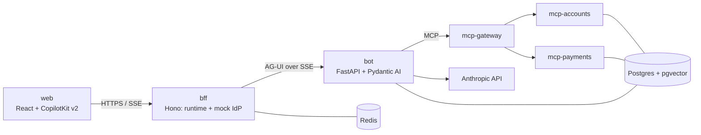

# Conversational Banking Assistant — POC

A proof of concept for a banking-grade chatbot that answers in Spanish, shows its sources and moves money only
after the customer approves it.

It proves one reference architecture end to end: answers streamed over SSE (AG-UI) that resume after a dropped
connection; generative UI, with model-built A2UI cards validated against a catalog and server-built templates for
anything transactional; RAG with citations over a knowledge base; an agent that calls domain tools over MCP through a
gateway, with audience-bound tokens per server; guardrails at the input, the tool call and the output; transfers that
need human approval plus a PIN step-up bound to the exact draft; and model failover with a backup per role.

> **Disclaimer.** This is a proof of concept, not production software. All data is synthetic. The identity provider
> is a mock that signs in whoever you pick and uses a fixed demo PIN. The project is not affiliated with, endorsed by
> or built for any bank; "Banco Demo" is fictional.

## Read more

- [`architecture.pdf`](architecture.pdf): the slides.
- [`docs/architecture.md`](docs/architecture.md): components, the token chain, request flows and the ADR index.
- [`docs/DEMO.md`](docs/DEMO.md): a click-by-click script for the five demo scenarios.
- [`docs/decisions/`](docs/decisions/): the architecture decision records.
- [`docs/backlog.md`](docs/backlog.md): known gaps and follow-ups.

## Architecture at a glance



One orchestrator agent loads domain skills on demand. Redis holds the thread event log that lets a stream resume, and
every service exports OpenTelemetry traces to Phoenix. The full picture is in
[`docs/architecture.md`](docs/architecture.md).

## Quick start

Prerequisites: Node 22+ and pnpm 12, uv 0.13+ (it installs Python 3.12 for the bot), Docker with Compose v2, and an
Anthropic API key (the bot calls Claude models, so running the demo spends paid tokens).

```sh
make install   # pnpm install + uv sync; also installs the pre-push hook
make set-key   # paste your Anthropic API key (hidden); saved to .env
make up        # copies .env.example to .env on first run, builds, waits until every container is healthy
make seed      # loads the mock bank: two customers, their accounts, movements and beneficiaries
make ingest    # chunks and embeds data/kb into pgvector (the first run downloads the embedding model)
```

Open <http://localhost:5173> and sign in as **Ana Gómez** or **Juan Pérez** (no password). The demo step-up PIN is
`123456`. [`docs/DEMO.md`](docs/DEMO.md) says what to type and what to expect.

Every service answers `GET /health`: web 5173, bff 3000, bot 8000, mcp-gateway 8100, mcp-accounts 8101,
mcp-payments 8102, Phoenix 6006. All ports bind to 127.0.0.1; if one is taken, set the matching `*_HOST_PORT` in
`.env` (for example `POSTGRES_HOST_PORT=5433`). `make help` lists every target.

## Checks

```sh
make lint                      # eslint, prettier, tsc, ruff, mypy
make contracts-check           # fail if the generated contract types are stale
make test                      # vitest + pytest; Postgres-backed tests run when the stack is up, skip otherwise
make eval                      # live evals + red team, gated by thresholds; needs the stack and an API key, costs tokens
pnpm --dir apps/web test:e2e   # Playwright against the live stack at 1280 and 390 px, in the installed Chrome
```

CI ([`.github/workflows/ci.yml`](.github/workflows/ci.yml)) runs `make contracts-check`, `make lint` and `make test`
against a seeded Postgres on every pull request and push to `main`, plus a weekly `pnpm audit`. It holds no secrets,
so the Playwright suite and `make eval`, which need the live stack and a paid model, run locally
([ADR 004](docs/decisions/004-local-checks-instead-of-ci.md)). The pre-push hook runs the same checks as CI.

## Repository layout

| Path                    | What it holds                                                                  |
| ----------------------- | ------------------------------------------------------------------------------ |
| `apps/web`              | React + Vite chat UI on CopilotKit v2: A2UI renderer and server-template cards |
| `apps/bff`              | Hono BFF: CopilotKit runtime proxying to the bot, Redis thread log, mock IdP   |
| `services/bot`          | FastAPI + Pydantic AI: orchestrator, skills, guardrails, RAG, evals (`evals/`) |
| `services/mcp-gateway`  | The bot's single MCP endpoint, in front of the two MCP servers                 |
| `services/mcp-accounts` | MCP server: accounts, balances, movements, spending summary                    |
| `services/mcp-payments` | MCP server: beneficiaries, prepare and execute transfer                        |
| `packages/contracts`    | JSON Schema source of truth, generating the TS and Pydantic types              |
| `packages/mcp-kit`      | Infrastructure shared by the Node MCP services                                 |
| `data/`                 | Synthetic Spanish knowledge base (`kb/`) and bank seed SQL (`seed/`)           |
| `infra/`                | `docker-compose.yml`: Postgres + pgvector, Redis, Phoenix and every service    |
| `docs/`                 | Plan, architecture, demo script, ADRs, backlog                                 |

## Security model

Eight rules shape the design, and each one needs a negative test. The full text is in [`AGENTS.md`](AGENTS.md).

1. The model never holds credentials: the bot exchanges the user's token for one per MCP server (bound `aud`, only
   the scopes it needs) and never forwards the incoming one.
2. Every tool declares a risk tier (T0 public read to T3 money movement), enforced by code, not by the prompt.
3. Money movement needs human approval plus a short-lived, single-use step-up token bound to the exact draft.
4. Confirm and receipt cards are server templates filled from tool results, never from model text.
5. A2UI payloads are validated against the catalog before they leave the bot; the catalog has no credential inputs.
6. Tool output is untrusted data and cannot trigger a write tool without a fresh policy check.
7. No PII in logs or traces.
8. User identity comes from the token, never from the request body or the model.

To report a vulnerability, see [`SECURITY.md`](SECURITY.md).

## License

[MIT](LICENSE).
