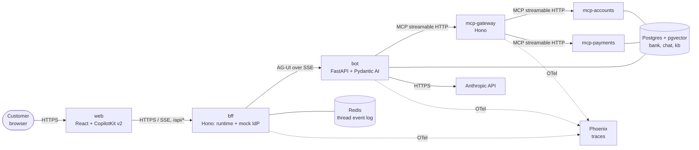
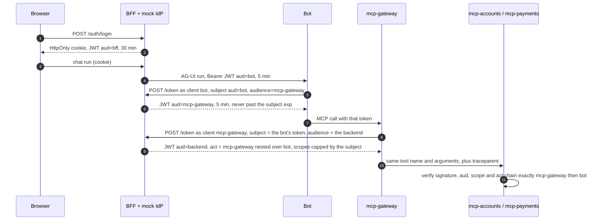
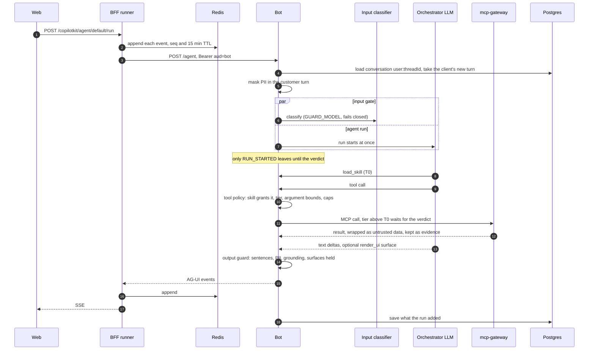
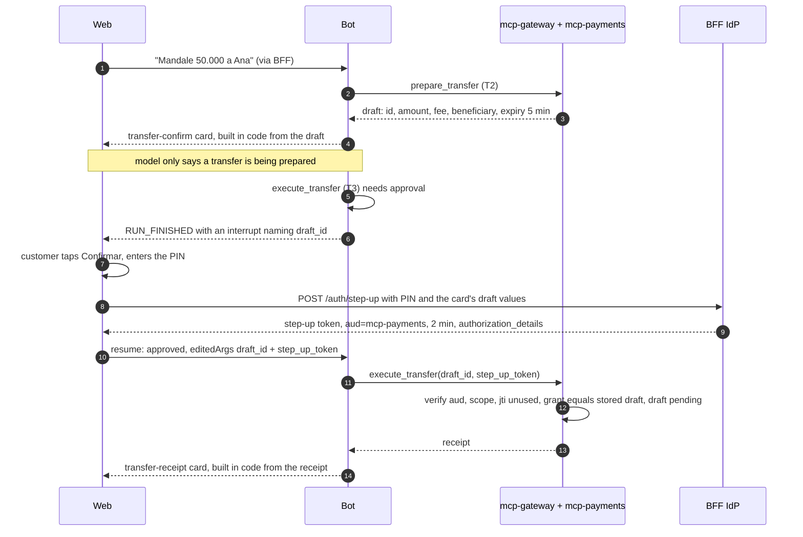
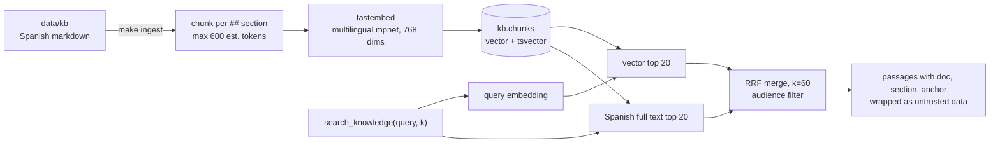
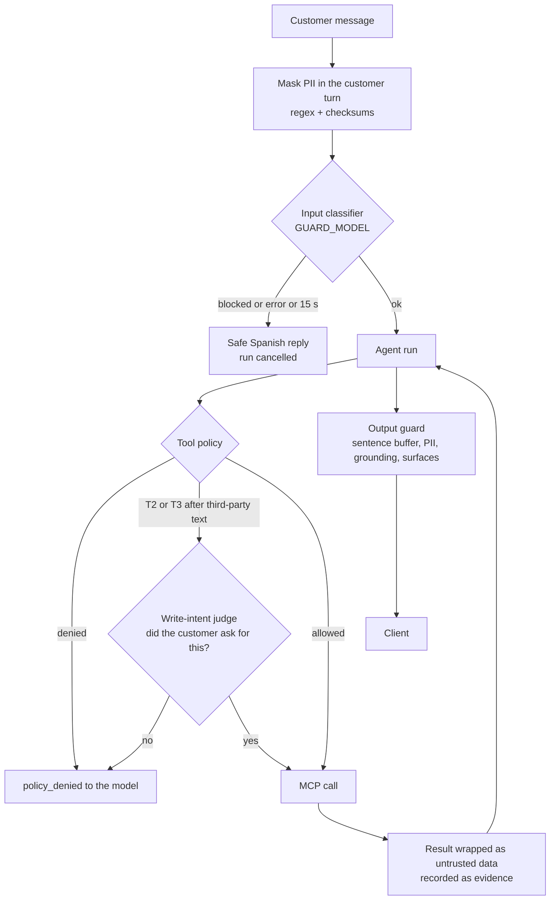
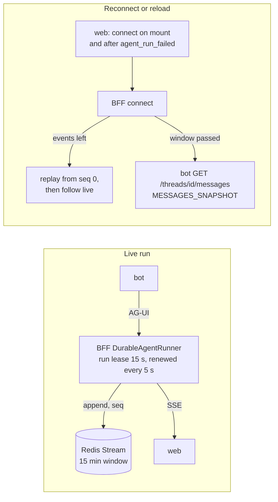

# Architecture

The shape of the system and how a request moves through it. Decisions and their alternatives are in the ADRs
([`decisions/`](decisions/), indexed at the end); what each module exposes is in its `feature_readme.md`;
how to run it is the [README](../README.md) and [`DEMO.md`](DEMO.md). This page links to those instead of
repeating them. Where it states a number, the code is the source: the file is named next to it.

## 1. Purpose and scope

A proof of concept for a banking-grade chatbot, built on synthetic data. It proves one reference architecture end to
end:

- **Streamed answers** over SSE (AG-UI), resumable after a dropped connection or a reload.
- **Generative UI**: model-built A2UI surfaces validated against a catalog, plus server-built templates for anything
  transactional.
- **RAG with citations** over a Spanish knowledge base.
- **One orchestrator agent** that loads domain skills on demand and calls tools over MCP, through a gateway.
- **Guardrails** at the input, the tool call and the output.
- **Money movement** that needs human approval and a step-up (PIN) bound to the exact transfer.
- **Evals** that gate quality, and traces without PII.

Out of scope (see [`PLAN.md`](PLAN.md)): multi-agent and A2A, a real IdP, production deployment, voice.

## 2. Components

The two MCP servers also export OTel to Phoenix (omitted above to keep the diagram readable). The bot calls the IdP
(inside the BFF) for token exchange, and the gateway does too; section 3 draws those calls.

| Part | Path | Role | Port |
| --- | --- | --- | --- |
| web | `apps/web` | Chat UI. Calls only its own origin (`/api/*`, proxied to the BFF, [ADR 006](decisions/006-session-cookie-and-same-origin-proxy.md)). | 5173 |
| bff | `apps/bff` | CopilotKit runtime that proxies runs to the bot, Redis-backed thread log, and the mock IdP (login, session cookie, token exchange, step-up, JWKS). | 3000 |
| bot | `services/bot` | The orchestrator agent, skills, guardrails, generative UI, RAG, conversation store. | 8000 |
| mcp-gateway | `services/mcp-gateway` | The bot's one MCP endpoint: catalog, per-customer rate limits, breaker per backend, audit line per call. | 8100 |
| mcp-accounts | `services/mcp-accounts` | Account tools (T1). | 8101 |
| mcp-payments | `services/mcp-payments` | Beneficiary, prepare and execute transfer tools. | 8102 |
| Postgres + pgvector | `infra/docker-compose.yml` | Schemas `bank`, `chat`, `kb` (section 13). | 5432 |
| Redis | `infra/docker-compose.yml` | Thread event log. Only the BFF uses it. | 6379 |
| Phoenix | `infra/docker-compose.yml` | OTLP collector and trace UI (also 4317 for gRPC). | 6006 |

Every host port binds to 127.0.0.1 and can be moved with its `*_HOST_PORT` variable. Shared code:
`packages/contracts` (JSON Schema, generated TS and Pydantic types, [ADR 003](decisions/003-generated-contracts-layout.md))
and `packages/mcp-kit` (token verification, the authenticated MCP route, risk-tier metadata;
[feature readme](../packages/mcp-kit/feature_readme.md), [ADR 009](decisions/009-mcp-servers-share-the-bank-database.md)).
Per-module interfaces: [web chat](../apps/web/src/features/chat/feature_readme.md),
[bff chat](../apps/bff/src/features/chat/feature_readme.md), [bff idp](../apps/bff/src/features/idp/feature_readme.md),
[bot chat](../services/bot/app/chat/feature_readme.md), [gateway](../services/mcp-gateway/src/features/proxy/feature_readme.md).

## 3. Token and trust chain (security rule 1)

The model never holds a credential, and no hop forwards the token it received. Each hop trades the token for one
with a narrower audience. The IdP's client policies (`apps/bff/src/features/idp/client-policies.ts`) say which
client may present which subject token and ask for which audience.

What each side refuses (each has a negative test, section 12):

- The IdP refuses client `bot` any audience except `mcp-gateway`, refuses a session token (`aud=bff`) as a subject,
  and refuses to chain a second hop from a backend token.
- The gateway accepts only a token whose actor chain is exactly `[bot]`; each backend accepts only `[mcp-gateway, bot]`
  (`packages/mcp-kit/src/jwt-verifier.ts`). A token the bot got directly for a backend is useless.
- Users are identified by the token's `sub`, never by a request body or the model (rule 8).

**Step-up token (rule 3)** is a separate path. The browser asks `POST /auth/step-up` with the PIN and the confirmed
draft's values. The IdP signs a 2-minute, single-use token: `aud=mcp-payments`, `token_use: step_up`, no `act`, and an
`authorization_details` claim (RFC 9396 shape) naming the draft, amount, currency and beneficiary. It travels as an
argument of `execute_transfer` through the bot and the gateway, which never read arguments. Only `mcp-payments` opens
it ([ADR 013](decisions/013-transfer-approval-and-step-up.md)). The model never sees it, and the BFF removes it from
the logged run input.

Token lifetimes are in `apps/bff/src/features/idp/token-issuer.ts`. Decisions: [ADR 008](decisions/008-token-exchange-and-mcp-audiences.md)
(exchange shape; partly superseded), [ADR 017](decisions/017-mcp-gateway.md) (the gateway hop and actor chains).

## 4. A chat turn

Notes:

- **Orchestrator and skills.** One agent (`services/bot/app/chat/agent.py`). The system prompt is server-owned;
  client-supplied state is ignored ([ADR 007](decisions/007-client-supplied-agent-input.md)). A skill is a markdown
  file with a tool allow-list and a `max_tier` (`services/bot/skills/`: `accounts` T1, `knowledge` T0, `payments` T3);
  `load_skill` makes its tools visible for the rest of the run ([skills readme](../services/bot/app/skills/feature_readme.md)).
  `render_ui` and `load_skill` are bot-local; everything else is a domain tool.
- **Risk tiers** (T0 public read, T1 personal read, T2 reversible write, T3 money movement) are declared in the tool's
  MCP `_meta` (`bank/riskTier`) and enforced by `PolicyToolset`, not by the prompt. A tool with no tier is denied
  ([policy readme](../services/bot/app/policy/feature_readme.md)).
- **Banking tools connect lazily.** A run that loads no banking skill makes no token exchange and opens no MCP session
  ([banking readme](../services/bot/app/banking/feature_readme.md)).
- **Where state lives.** Events: Redis, owned by the BFF, a 15-minute replay window. Conversation history: Postgres
  `chat` schema, owned by the bot, scoped to the user. The two are independent, which is what makes a reload past
  the window possible (section 9).
- **Models** come from env (`BOT_MODEL`, `GUARD_MODEL`), each with an optional failover chain (section 9).

## 5. Money movement (rules 3 and 4)

- **What is model-generated and what is not.** The model decides that a transfer is being prepared and writes a short
  line. The confirm and receipt cards are server templates (`transfer-confirm`, `transfer-receipt`) built from the MCP
  tool result by `TemplateToolset` (`services/bot/app/genui/templates.py`) and sent as `bank-template`
  `ACTIVITY_SNAPSHOT`s ([ADR 011](decisions/011-server-templates-as-activity-messages.md)). The approval footer reads the
  card in the thread, never the interrupt's model-proposed arguments.
- **Pause.** `PolicyToolset` raises `ApprovalRequired` for any T3 call without approval; the run ends as an AG-UI
  interrupt. `step_up_token` is hidden from the model's schema and arrives only in the approved arguments. CopilotKit's
  own tool answer, which would carry the token into every later request, is dropped by the BFF runner and again by the
  bot's adapter (`interrupt_answers.py`).
- **Resume.** A resume skips the input classifier only when it answers an interrupt this bot raised for this user and
  thread (`PendingApprovals`, 5-minute memory), so a forged resume is classified like any message.
- **`execute_transfer` in `mcp-payments`** (`services/mcp-payments/src/features/transfers/`): the access token needs
  scope `transfers:execute`; the step-up token is verified (signature, issuer, `aud`, `exp`, `token_use`, scope);
  its `sub` must be the caller; its `jti` is claimed first (single use); the grant must equal the stored draft; the
  draft must be pending and unexpired. Execution is one transaction under the draft's row lock, idempotent per draft.
- **Failed resume.** If the resume run fails, the card says so and the customer asks again; the bot raises a new
  interrupt for the same draft and `mcp-payments` never debits a draft twice.
- Three wrong PINs lock step-up for five minutes (`apps/bff/src/features/idp/step-up.ts`).

Interfaces: [approval](../apps/web/src/features/approval/feature_readme.md),
[transfers](../services/mcp-payments/src/features/transfers/feature_readme.md),
[policy](../services/bot/app/policy/feature_readme.md). Decision: [ADR 013](decisions/013-transfer-approval-and-step-up.md).

## 6. Generative UI

Two kinds of UI leave the bot, with different trust:

| | A2UI surfaces | Server templates |
| --- | --- | --- |
| Built by | The model, through the `render_ui` tool | Code, from an MCP tool result |
| Used for | Charts, lists, tables, citations, quick replies | Transfer confirm and receipt |
| Contract | `packages/contracts/schemas/a2ui-catalog.json` (`bank-catalog-v1`) | `packages/contracts/schemas/bank-templates.json` |
| Event | `ACTIVITY_SNAPSHOT`, type `a2ui-surface` | `ACTIVITY_SNAPSHOT`, type `bank-template` |
| Checks before the client | Validated against the catalog; PII masked; numbers grounded | Passes untouched: its data never came from model text |

- **Validation and fallback.** `render_ui`'s argument schema is the contract's `UiTree` (catalog components only,
  under one root `Card`). An invalid tree is dropped, logged as `a2ui.invalid_payload`, and the model gets a text
  fallback. The catalog has no input components: no login, PIN, password or card-number field can be rendered
  ([ADR 012](decisions/012-agent-side-a2ui-generation.md)).
- **What the client never sees.** The raw `render_ui` call and every reasoning event are withheld by the output guard;
  the client gets only the validated surface.
- **Ordering.** The output guard holds model-built surfaces until the end of the next text message, so the customer
  reads the answer first and the card under it.
- **Rendering.** The web app registers the catalog with CopilotKit's A2UI renderer and a separate renderer for
  `bank-template` ([genui readme](../apps/web/src/features/genui/feature_readme.md),
  [bot genui readme](../services/bot/app/genui/feature_readme.md)).

## 7. RAG

- **Ingest** (`python -m app.knowledge.ingest`, `make ingest`): one chunk per `##` section, split by paragraph past
  600 estimated tokens, embedded locally with `sentence-transformers/paraphrase-multilingual-mpnet-base-v2`
  (768 dims, `EMBEDDING_MODEL`) behind an `Embedder` protocol so another provider can replace it. It replaces the
  `kb` schema (HNSW index on the vector, GIN on the generated Spanish `tsvector`).
- **Search** is the `search_knowledge` tool (T0): the vector and full-text lists fused by reciprocal rank fusion in
  Python, filtered by audience (`public` or `customer`) in SQL.
- **Citations.** Each passage carries `doc_id`, `title`, `section` and `anchor`; the `knowledge` skill has the model
  answer in text and add a `Citation` component naming the pages it used. With no hit the answer is "No tengo esa
  información". The eval suite scores both (section 11).

Decision and the model comparison: [ADR 010](decisions/010-embeddings-chunking-and-hybrid-search.md).
Interface: [knowledge readme](../services/bot/app/knowledge/feature_readme.md).

## 8. Guardrails

All in `services/bot/app/guardrails/` and `services/bot/app/policy/` ([ADR 014](decisions/014-guardrails.md)):

- **Input.** PII is masked before the classifier, the model, logs or traces see it. The classifier (categories ok,
  prompt injection, jailbreak, other customer's data, credentials, off topic) runs concurrently with the first model
  call. Until its verdict only `RUN_STARTED` leaves; tools above T0 wait for it; a blocked or failed classifier
  (timeout 15 s) refuses the run. `RunGuard.unchecked()` is blocked by default, so code that skips the gate cannot
  reach personal data.
- **Tool policy.** A tool is callable only if it declares a tier, a loaded skill lists it and the tier is within the
  skill's `max_tier`. Argument bounds fail closed (at most 50 transactions, periods of at most 400 days, transfers up to
  ARS 2,000,000 or USD 10,000). **Frequency caps**: per conversation, 5 T2 and 3 T3 calls per 10 minutes, in memory.
- **Untrusted tool data.** Every domain-tool result reaches the model as `{"untrusted_data": ..., "note": ...}`.
  After a result that holds third-party text (`list_transactions` memos and merchants, `search_knowledge` passages),
  a T2 or T3 call is re-checked by the **write-intent judge**: do the customer's last three messages ask for this exact
  action, recipient and amount? An approved T3 resume is not re-judged.
- **Output.** Text is released a sentence at a time. Each sentence passes a PII-leak check and a **grounding** check:
  an amount, percentage, date or account number must appear in this run's domain-tool results or in earlier turns'.
  A failing sentence becomes a fallback; surfaces get PII masked and are dropped when a number is ungrounded. A
  `RUN_ERROR` reaches the client as a fixed Spanish message.

## 9. Resilience

**Resumable streams** ([ADR 015](decisions/015-resumable-streams.md)).

- The run belongs to the BFF process, not to the HTTP request: a client that disconnects only stops reading.
  `connect` replays the logged events and then follows the live ones from the last `seq`; CopilotKit resets its
  transcript first, so the answer shows once. Another user's thread yields nothing.
- A run whose lease lapsed without a terminal event is closed with a `RUN_ERROR`.
- The web app (`apps/web/src/features/chat/lib/reconnector.ts`) reconnects with backoff of 0.5 to 8 s, five tries,
  and waits for the browser's `online` event when offline.
- **Past the window**, the bot's stored conversation is returned as a transcript: user and assistant text plus the
  stored confirm and receipt cards. Each stored answer is passed through the output guard's deterministic checks again
  (PII, grounding) so a reload cannot show what the stream would have withheld. It has no A2UI surfaces (F34).

**LLM failover** ([ADR 018](decisions/018-llm-model-failover.md), `services/bot/app/core/llm/`). One `FallbackModel`
chain per role: the orchestrator (`BOT_MODEL`, then `BOT_MODEL_FALLBACKS`, default Haiku) and the guard
(`GUARD_MODEL`, then `GUARD_MODEL_FALLBACKS`, default Sonnet). It fails over on a rate limit, overload, unavailability,
server or connection error and timeouts, never on a rejected request or quota. The orchestrator has a 10 s deadline
for the first event of each model (`LLM_FIRST_EVENT_TIMEOUT_SECONDS`); a failure after a stream began is not retried.
A circuit breaker skips a model that already failed in this run, and opens per process after 3 failures in 60 s for
30 s. The guard chain keeps the input gate inside its 15 s fail-closed budget. The customer never sees a failover.

**MCP gateway** (`services/mcp-gateway`). Per backend, a breaker opens after 5 consecutive failures for 30 s and
then lets one probe through; a down backend fails its own tools at once and the other keeps working
(`service_unavailable`). Rate limits per customer: T1 120 per minute, T2 20 and T3 10 per 10 minutes. Both are in
memory, so they are per replica.

## 10. Observability

- **Traces.** Every service exports OpenTelemetry to Phoenix (`OTEL_EXPORTER_OTLP_ENDPOINT`). `traceparent` is
  propagated by HTTP auto-instrumentation (undici in Node, httpx in Python) from the BFF through bot, gateway and
  backends, so one customer turn is one trace (the browser is not instrumented). Agent spans keep structure (model, tool names, tokens, timings) but no
  prompts, completions or arguments (`include_content=False`).
- **No PII in logs or traces (rule 7).** A logging filter redacts messages, `extra` fields and exception text; a
  `RedactingSpanExporter` wraps the OTLP exporter in the bot ([ADR 014](decisions/014-guardrails.md)). The gateway
  never reads or logs tool arguments.
- **Audit.** The gateway writes one `mcp.tool_call` line per call: customer id, tool, tier, outcome, duration.
- **Metrics.** `make metrics` reads the bot's `bot.stream` spans (time to first token and first UI surface, p50 and
  p95), tokens per run from the pydantic-ai `chat` spans, the prompt-cache share, and `guardrail.*` and failover
  counts from the logs. `make pii-scan` fails when the seed's PII (names included) appears in container logs or
  Phoenix traces. Both are described in [`DEMO.md`](DEMO.md#3-checking-it-make-eval-and-make-metrics) and [ADR 016](decisions/016-evals.md).
- Phoenix runs without auth, bound to loopback, because the data is synthetic ([ADR 005](decisions/005-phoenix-auth-off-locally.md)).

## 11. Evals and quality gates

`make eval` (`services/bot/evals/`, needs `make up`, `make ingest` and an API key) re-seeds the bank and drives the
live stack through the BFF as a browser session: chat turns, the full transfer flow with step-up and resume, and a
dropped-connection resume. Judging reads what the client received, and "money moved exactly once" is read from
Postgres. It gates on `evals/thresholds.yaml`:

| Gate | Cases | Pass rate |
| --- | --- | --- |
| `scenario` | Golden cases for demo scenarios 1, 2, 3 and 5 | 1.0 |
| `kb_grounding` | KB answers and honest "no tengo esa información" | 0.8 |
| `tool_selection` | Right skill, tool and arguments | 0.8 |
| `redteam` | Scenario 4 attacks in `redteam.yaml`, blocked or safely handled | 0.95 |
| `controls` | Legitimate requests that must not be over-blocked | 1.0 |
| `judge_quality`, `judge_citation` | LLM judge on `GUARD_MODEL`, mean score | 0.8 each |

`make eval-backup` runs the same suite with both primaries forced to fail so the backups answer; only
`judge_quality` relaxes, to 0.7 (`backup_mode` in the file). A partial run still applies every gate. Costs real
tokens and resets the shared bank data (F29). Reasoning for each value: [ADR 016](decisions/016-evals.md). The web
app's Playwright suite (`apps/web/e2e/`) covers the scenarios at 1280 and 390 px.

## 12. Security rules, where enforced, how tested

Rule text: [`AGENTS.md`](../AGENTS.md).

| # | Rule | Enforced in | Negative tests |
| --- | --- | --- | --- |
| 1 | No credentials in the model; exchange, no passthrough | `apps/bff/src/features/idp/client-policies.ts`, `packages/mcp-kit/src/jwt-verifier.ts`, `services/bot/app/banking/token_exchange.py` | `apps/bff/test/features/idp/gateway-exchange.test.ts`, `packages/mcp-kit/test/jwt-verifier.test.ts`, `services/mcp-gateway/test/features/proxy/token-chain.test.ts`, `services/bot/tests/banking/test_mcp_end_to_end.py` |
| 2 | Risk tiers enforced by policy | `services/bot/app/policy/tool_policy.py`, `policy_toolset.py`, `packages/mcp-kit/src/risk-tier.ts` | `services/bot/tests/policy/test_tool_policy.py`, `test_guarded_policy.py` |
| 3 | T3 needs approval and step-up | `services/bot/app/policy/policy_toolset.py`, `apps/bff/src/features/idp/step-up.ts`, `services/mcp-payments/src/features/transfers/execute-transfer.ts`, `step-up-verifier.ts` | `services/bot/tests/policy/test_approval_flow.py`, `apps/bff/test/features/idp/step-up.test.ts`, `services/mcp-payments/test/features/transfers/execute-transfer.test.ts` |
| 4 | Transactional UI is never model-generated | `services/bot/app/genui/templates.py` | `services/bot/tests/genui/test_templates.py` |
| 5 | A2UI validated before it leaves the bot | `services/bot/app/genui/render_ui.py`, `a2ui.py`, `guardrails/output_guard.py`, `packages/contracts/schemas/a2ui-catalog.json` | `services/bot/tests/genui/test_render_ui.py`, `services/bot/tests/guardrails/test_output_guard.py` |
| 6 | Tool output is untrusted data | `services/bot/app/policy/policy_toolset.py`, `guardrails/write_intent.py` | `services/bot/tests/policy/test_guarded_policy.py` |
| 7 | No PII in logs or traces | `services/bot/app/guardrails/log_redaction.py`, `span_redaction.py`, `pii.py`; `make pii-scan` | `services/bot/tests/guardrails/test_redaction.py`, `test_pii.py` |
| 8 | Identity from the token only | `services/bot/app/auth/`, `chat/deps.py`; `Principal.sub` in `packages/mcp-kit` | `services/bot/tests/chat/test_agent_endpoint.py`, `services/mcp-accounts/test/features/accounts/account-tools.test.ts` |

## 13. Data model

One Postgres database, three schemas, each with one owner.

| Schema | Owner | Tables | Reset by |
| --- | --- | --- | --- |
| `bank` | `mcp-accounts`, `mcp-payments` | `customers`, `accounts` (ARS and USD), `transactions`, `beneficiaries`, `transfer_drafts` (pending, executed, expired, cancelled), `transfers` (one per draft), `used_jtis` (spent step-up tokens). Defined in `data/seed/001_schema.sql`. | `make seed` |
| `chat` | bot | `conversations`, `conversation_entries`: Pydantic AI's `ConversationStore`, revision-checked writes, id `"{user}:{threadId}"`. | nothing (created at startup) |
| `kb` | bot | `chunks`: `doc_id`, `title`, `audience`, `heading`, `anchor`, `content`, `embedding`, generated `tsv`. | `make ingest` |

Redis holds, per thread, the event stream, an owner key (24 h) and a run lease. Seed users are Ana Gómez and Juan
Pérez; everything is synthetic. Both MCP servers share the `bank` schema on purpose
([ADR 009](decisions/009-mcp-servers-share-the-bank-database.md)).

## 14. Known limits and next steps

The tracker is [`backlog.md`](backlog.md). The ones that shape the architecture:

- **Scope widening (F42).** The bot's `aud=mcp-gateway` token carries the full banking scope ceiling whatever skill is
  loaded, and the gateway asks each backend for its ceiling. Narrowing by loaded skill is the next step.
- **Gateway rough edges (F43 to F45).** Uncached `tools/list` exchanges, rate-limit counting of refused calls, a
  backend that was down at first refresh staying unknown to `tools/call`.
- **Per-process state.** Frequency caps, gateway limits, breakers and the BFF's `stop` are per process; a run dies with
  its BFF (F24). Moving them to Redis is the path to replicas.
- **Reload fidelity (F25, F34).** Past the replay window a reload restores text and confirm and receipt cards, not
  A2UI surfaces.
- **Client reconnection (F47, F48)** and **guard history on edit or regenerate (F49)**.
- **Mock IdP.** Stateless sessions, no logout revocation (F2), fixed PIN.
- **Gateway direction.** [ADR 017](decisions/017-mcp-gateway.md) weighed agentgateway; the small Hono service stands
  in for it. Replacing it, with shared rate limits across replicas, is the production step.
- **Evals** share the demo database (F29) and do not count judge tokens (F30).

## 15. ADR index

| ADR | Title | In one line |
| --- | --- | --- |
| [001](decisions/001-typescript-6.md) | Pin TypeScript to 6.0 | One compiler version across the workspace. |
| [002](decisions/002-node-service-runtime.md) | Hono for every Node service | Shared server, logger and env idiom; images install their workspace slice. |
| [003](decisions/003-generated-contracts-layout.md) | Generated contracts are committed | JSON Schema to TS and Pydantic in two fixed places, drift checked pre-push. |
| [004](decisions/004-local-checks-instead-of-ci.md) | Local checks; CI added once public | Pre-push hook and CI's fast tier run contracts-check, lint and test; e2e and evals stay local. |
| [005](decisions/005-phoenix-auth-off-locally.md) | Phoenix auth off locally | Loopback-only, synthetic data, no span content. |
| [006](decisions/006-session-cookie-and-same-origin-proxy.md) | Session cookie and same-origin proxy | HttpOnly cookie, the browser never sees a token, `/api/*` proxied. |
| [007](decisions/007-client-supplied-agent-input.md) | What the bot trusts from a run input | Identity from the token; client state and system prompt ignored. |
| [008](decisions/008-token-exchange-and-mcp-audiences.md) | Token exchange and MCP audiences | RFC 8693 form, logical audiences, ceilings that only narrow (partly superseded by 017). |
| [009](decisions/009-mcp-servers-share-the-bank-database.md) | MCP servers share the bank database | One `bank` schema, shared plumbing in `@poc/mcp-kit`. |
| [010](decisions/010-embeddings-chunking-and-hybrid-search.md) | Embeddings, chunking, hybrid search | Local multilingual model, section chunks, vector plus full text fused with RRF. |
| [011](decisions/011-server-templates-as-activity-messages.md) | Server templates as activity snapshots | `bank-template` activities carry the transactional cards. |
| [012](decisions/012-agent-side-a2ui-generation.md) | Agent-side A2UI generation | Bot-owned `render_ui`, validated against the catalog. |
| [013](decisions/013-transfer-approval-and-step-up.md) | Transfer approval and step-up | AG-UI interrupt, step-up token in approved arguments, RAR binding checked by the resource server. |
| [014](decisions/014-guardrails.md) | Guardrails | Input gate, sentence-buffered output guard, redaction at the exporters. |
| [015](decisions/015-resumable-streams.md) | Resumable streams | Redis-backed runner in the BFF, server-owned history in Postgres. |
| [016](decisions/016-evals.md) | Evals | Live suite through the BFF, LLM judge, thresholds in config, metrics as a script. |
| [017](decisions/017-mcp-gateway.md) | MCP gateway | One more hop in the exchange chain, actor chains, limits, breaker, audit. |
| [018](decisions/018-llm-model-failover.md) | LLM failover | In-process chain per role, first-event deadline, circuit breaker. |
| [019](decisions/019-copilotkit-advisory-overrides.md) | Dependency advisories | pnpm overrides for undici and graphql-scalars; zod 3's advisory accepted until A2UI moves to zod 4. |
| [020](decisions/020-skill-scoped-gateway-tokens.md) | Skill-scoped gateway tokens | Proposed: the gateway token carries only the loaded skills' scopes, `transfers:execute` only for an approved call; the gateway lists and calls by token scope. |
